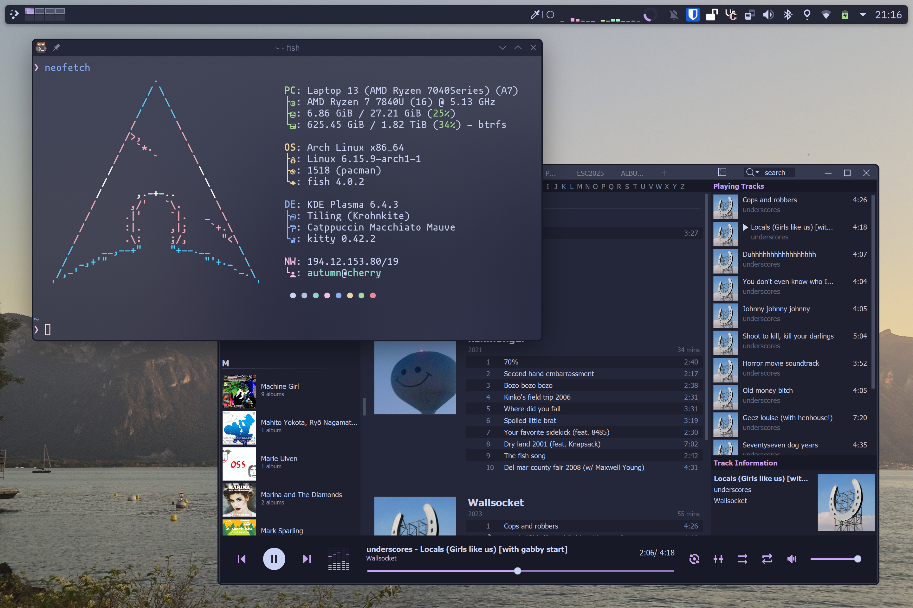

## arch-setup

A set of scripts I use to do most of the post-install setup for a fresh arch installation.

Doesn't set everything up, but does enough to save me time when I need it.

```
sudo pacman -Syu git
git clone https://github.com/autumn-mck/arch-setup
cd arch-setup
chmod +x *.sh
./pre-reboot.sh
reboot
cd arch-setup
./main.sh
./fish.sh
./amd.sh
```


